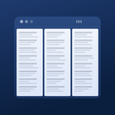

<p align="center">
  
</p>

<h1 align="center">Multi Column X</h1>

<p align="center">
  A TweetDeck-style Twitter/X client.<br>
  A desktop / Android app built with Tauri v2 that shows multiple accounts and multiple columns side by side.
</p>

<p align="center">
  <a href="https://github.com/natsuyasai/multi-column-x/actions/workflows/ci.yml"></a>
  <a href="https://github.com/natsuyasai/multi-column-x/releases/latest"></a>
  
  
  
  
</p>

<p align="center">
  <a href="https://github.com/natsuyasai/multi-column-x/releases/latest">Download</a> ·
  <a href="https://natsuyasai.github.io/multi-column-x/en/">User Guide</a> ·
  <a href="docs/development/README.md">Development Notes (Japanese)</a> ·
  <a href="README.md">日本語</a>
</p>

<p align="center">
  
  
</p>

## Features

- **Multi-account support** — Each account keeps its own independent session (cookies)
- **Column layout** — Show any number of Home, Notifications, Search, List, custom URL, compose-only, and external URL (account-independent) columns side by side
- **Grid layout** — Arrange columns in a matrix with `gridRow` / `gridCol`. Columns can be stacked vertically within a grid column
- **Column settings** — Per-column auto-refresh interval, header hiding, and custom CSS
- **Auto-refresh** — Reloads at the configured interval, and skips the refresh while you are scrolling
- **Back-to-previous-boundary button** — When auto-refresh brings in new posts on a Home column, jump back to the previous top of the timeline (the boundary with what you have already read) in one tap
- **Media popups** — Open image and video links in a separate window
- **Video long-press menu** — Long-press a video in a column (right-click on PC) to open it in a popup or download it (download is Android only)
- **Link popups** — Open any URL in a dedicated window
- **Compose window** — Open a post-composer window from the TopBar / mobile tab bar
- **Popup session switching** — Switch the account of a popup window on the spot
- **Custom context menu** — Extends the WebView right-click menu
- **Video autoplay blocking** — Stops videos from autoplaying when a page loads
- **Muted words / allowlist** — Filter timelines with per-column and global muted words; when an allowlist is set, only posts containing those words are shown
- **Hide reposts** — Hide reposts from specified users, per column or globally
- **Hide the header on the Notifications page** — Automatically hides the header (including the settings link) of Notifications columns
- **Image shrinking / blur / ad hiding** — Per-column timeline display adjustments
- **New-post badges and desktop notifications** — A new-post count badge per column, and desktop notifications for Notifications columns
- **API rate-limit monitor** — Shows the rate-limit status of X's internal API in a toolbar popover
- **Keyboard shortcuts** — Compose, add a column, jump to columns 1-9, and more (also work while a column WebView has focus)
- **Theme switching** — Dark / Light / follow the system
- **Presets** — Save and switch column layouts (desktop)
- **TopBar navigation** — Add columns, manage accounts, and open settings from a horizontal toolbar; reorder columns by drag and drop, one grid column at a time (desktop)
- **Auto-update** — Check for and apply updates from GitHub Releases, with a What's New display (Windows / Linux AppImage / Android APK; the Linux deb package must be updated manually)
- **Automatic crash recovery** — Detects a Linux WebProcess crash and recreates the column WebViews automatically
- **Android support** — A mobile tab bar UI and a swipe bar to switch between columns, and multiple columns at once (2 to 6 columns) on wide screens such as tablets and landscape orientation

## Download and installation

From **Assets** on the [latest release page](https://github.com/natsuyasai/multi-column-x/releases/latest), download the file for your OS (`.exe` for Windows, `.AppImage` for Linux, `.apk` for Android) and run it.

| OS      | Distribution   |
| ------- | -------------- |
| Windows | Installer      |
| Linux   | AppImage / deb |
| Android | APK            |

See the [User Guide](https://natsuyasai.github.io/multi-column-x/en/install) for installation steps and first-time setup. After installing, you can update to the latest version with the in-app auto-update.

## Usage

1. Add an account (toolbar "Accounts" → "+ Add account" → log in to X)
2. Add a column (toolbar "Add column", then choose an account and a page type)
3. Configure grid placement, auto-refresh, muted words, and so on as needed

The [User Guide](https://natsuyasai.github.io/multi-column-x/en/) covers how to read the screen, the settings, shortcuts, operation on Android, and the FAQ.

## Tech stack

| Layer          | Technology                      |
| -------------- | ------------------------------- |
| Frontend       | React 19 + TypeScript + Vite    |
| Styling        | SCSS Modules                    |
| State          | Zustand                         |
| Backend        | Rust + Tauri v2                 |
| Settings store | tauri-plugin-store v2           |
| Testing        | Vitest + @testing-library/react |

## Development

### Prerequisites

- [Node.js](https://nodejs.org/) 22 or later
- [Rust](https://rustup.rs/) / Cargo
- [Tauri prerequisites](https://tauri.app/start/prerequisites/) (WebView2, etc.)

If Cargo is not found on Windows, add `%USERPROFILE%\.cargo\bin` to your PATH.

### Setup and launch

```bash
npm install
npm run tauri:dev
```

### Build

```bash
npm run tauri:build          # Release build
npm run tauri:build:debug    # Debug build
npm run tauri:android:build  # Android build
```

### Tests and quality checks

```bash
npm test                     # Vitest unit tests
npm run test:property        # fast-check property tests
npm run test:story           # Storybook play function (chromium)
npm run lint                 # ESLint
npm run typecheck            # tsc --noEmit
npm run lint:rust            # cargo clippy (-D warnings)
cd src-tauri && cargo test   # Rust unit tests
```

## Documentation

The development documents are written in Japanese.

| Document                                                           | Contents                                                                 |
| ------------------------------------------------------------------ | ------------------------------------------------------------------------ |
| [User Guide](https://natsuyasai.github.io/multi-column-x/en/)      | How to use the app (for users)                                           |
| [Development notes index](docs/development/README.md)              | Design decisions, pitfalls, and the background of specs (for developers) |
| [Project structure](docs/development/project-structure.md)         | File layout of `src/`, `src-tauri/`, and the Android Kotlin layer        |
| [Tauri command list](docs/development/tauri-commands.md)           | App-specific commands and the ACL update rules                           |
| [Architecture notes](docs/development/architecture-overview.md)    | WebView, remote capability, update security, and conditional compilation |
| [Linux column WebView spec](docs/development/linux-column-spec.md) | Placement, clipping, crash handling, and GStreamer bundling              |
| [CLAUDE.md](CLAUDE.md)                                             | Development guidelines and architectural constraints                     |
