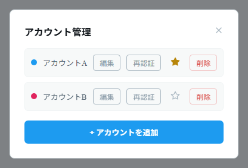

# Adding an Account

1. Click the **Accounts** (person icon) button on the toolbar (`Ctrl+Shift+A`) to open **Manage accounts**.
2. Click **"+ Add account"** to open the X login window.
3. Log in to X as usual. When the login is detected as complete, the account is added automatically.
4. To register multiple accounts, repeat steps 2 and 3.

_Each account has "Edit", "Re-authenticate", and "Delete" buttons, along with a ★ to mark the default account. (The screenshot shows the Japanese UI.)_

## What you can do in account management

- **Color** — Each account is assigned a color, which you can use to tell accounts apart by the column header and tab colors. Use the "Edit" button to change the account name and color.
- **Default account (★)** — Click the ★ button to make an account the one used first when composing a post.
- **Re-authenticate** — Use the "Re-authenticate" button to log in again and refresh the session, for example when cookies have become invalid.
- **Delete** — Use the "Delete" button to delete an account. The account's login data is also deleted.

> Each account keeps its own independent session, so you can stay logged in to multiple accounts at the same time on the same device.
