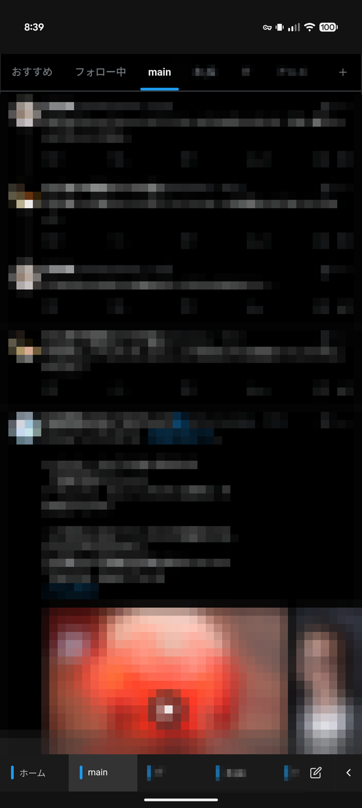
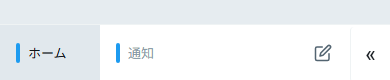
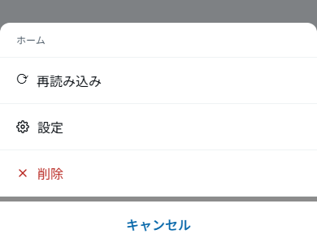
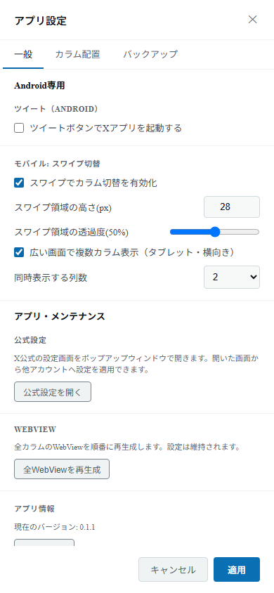
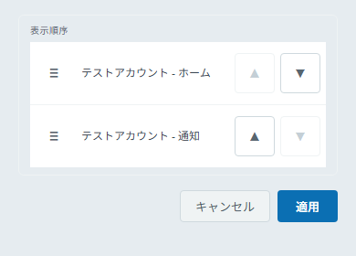

# Using on Android

See [Supported Environments and Features](./environments) for differences from the desktop versions (Windows / Linux).

## Screen layout

_Use the tab bar at the bottom of the screen to switch columns (tabs) and use the menu (the timeline contents are mosaicked). The screenshot shows the Japanese UI._

You operate the app with the **tab bar** at the bottom of the screen.

- Each **tab** is one column. Tap it to switch to that column.
- Tabs are colored with the account's color, and the active column shows the auto-reload countdown.
- The **✏️** (compose post) button is always shown.
- Opening and closing the menu with the **« / »** button reveals the following action buttons.
  - 🔗 Open URL in popup
  - ⚙️ App settings
  - 👤 Manage accounts
  - ＋ Add column
  - API rate limit display (when "Enable the API usage monitor" is on in the app settings)
- When a larger text size means the buttons no longer fit on screen, opening the menu scrolls it to the right end, and the edge with hidden buttons fades out. Swipe the menu left or right to reach the hidden buttons.

_Each tab is one column. Use the button on the right to open and close the menu._

## Long-press menu on a tab

**Long-press** a tab (or perform the equivalent of a right-click) to open the action menu.

- **Settings** — Opens that column's individual settings.
- **Delete** — Deletes that column. A confirmation dialog appears, and the column is deleted when you choose Delete. For an external site column, its data, such as login information, is deleted as well.
- **Reload** — Reloads that column.

_Long-press a tab to open a menu where you can choose Reload, Settings, or Delete._

## Android-only settings

In App settings, an **"Android"** category is shown on Android only (post button behavior, swipe switching, and multi-column display on wide screens). The "Media" category shows the popup settings for images and videos (the desktop "Close with the Esc key" option is not shown). See "Showing multiple columns at once" below.

_Configure swipe switching and multi-column display in the "Android" category._

In the "Backup" category you can export and restore your settings ([Backup and restore](./settings#backup-and-restore-advanced)). On Android, you choose where to save and load files with the device's file picker.

## Swipe to switch columns

Swipe left or right on the swipe area near the tab bar to switch to the adjacent column.
You can adjust whether it is enabled, the height of the area, and its opacity under App settings → "Android" → **"Mobile: swipe to switch"**.

You can change the column order in the "Column layout" category in the app settings.

_In the Android "Column layout" category, use ▲ / ▼ under "Display order" to reorder columns._

## Showing multiple columns at once (tablets and landscape)

Enable **"Show multiple columns on wide screens (tablet / landscape)"** in App settings → the **"Android"** category to show several columns side by side on wide screens (landscape, tablets, etc.). This works on supported devices only.
Once enabled, you can choose the **number of columns** to show (2 to 6; the default is 2).

- When the screen width is under about 600dp, one column is shown regardless of the setting.
- If the number of columns you choose cannot fit at about 300dp per column, it is automatically reduced to the largest number that fits.
- Columns are laid out consecutively starting from the one currently shown (the active column). Near the end, the layout shifts left so that the last column fits at the right edge.
- If you have fewer columns than the number you set, only the columns you have are shown.

### Image and video popups

Only while multiple columns are shown at once, tapping an image or video in the timeline opens it in a full-screen popup (for videos, tapping either the play button or the thumbnail works). Use the back gesture to close the popup.

- With a single column (phones, portrait, split screen, etc.), media opens inside the column as before. When the number of columns changes, for example by rotating the device, the behavior switches accordingly.
- You can turn the image and video popups on or off separately in App settings → the "Media" category.

## Composing posts

If you enable "Launch the X app with the post button" under **"Posting (Android)"** in the app settings, the ✏️ button opens the X app on your device so you can post from there (when disabled, the in-app compose screen is used).
