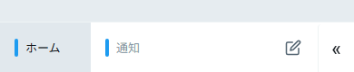
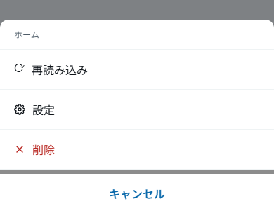
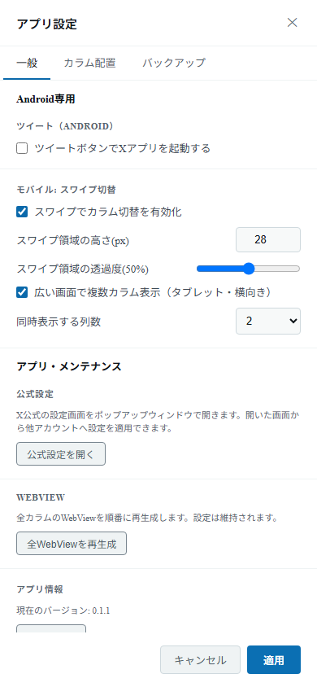
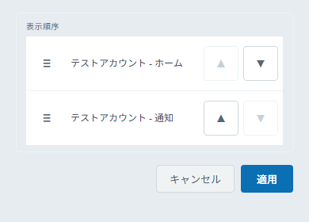

# Using on Android

See [Supported Environments and Features](./environments) for differences from the desktop versions (Windows / Linux).

## Screen layout

_Use the tab bar at the bottom of the screen to switch columns (tabs) and use the menu (the timeline contents are mosaicked). The screenshot shows the Japanese UI._

You operate the app with the **tab bar** at the bottom of the screen.

- Each **tab** is one column. Tap it to switch to that column.
- Tabs are colored with the account's color, and the active column shows the auto-reload countdown.
- The **✏️** (compose post) button is always shown.
- Opening and closing the menu with the **« / »** button reveals the following action buttons.
  - 🔗 Open URL in popup
  - ⚙️ App settings
  - 👤 Manage accounts
  - ＋ Add column
  - API rate limit display (when "Enable the API usage monitor" is on in the app settings)

_Each tab is one column. Use the button on the right to open and close the menu._

## Long-press menu on a tab

**Long-press** a tab (or perform the equivalent of a right-click) to open the action menu.

- **Settings** — Opens that column's individual settings.
- **Delete** — Deletes that column.
- **Reload** — Reloads that column.

_Long-press a tab to open a menu where you can choose Reload, Settings, or Delete._

## Android-only settings

Under App settings → "General", an **"Android only"** group is shown on Android only (post button behavior, swipe switching, and multi-column display on wide screens). The "Popup windows" items for desktop are not shown.

_Configure swipe switching and multi-column display in the "Android only" group._

On the "Backup" tab you can export and restore your settings ([Backup and restore](./settings#backup-and-restore-advanced)). On Android, you choose where to save and load files with the device's file picker.

## Swipe to switch columns

Swipe left or right on the swipe area near the tab bar to switch to the adjacent column.
You can adjust whether it is enabled, the height of the area, and its opacity under App settings → "General" → **"Mobile: swipe to switch"**.

You can change the column order on the "Column layout" tab in the app settings.

_On the Android "Column layout" tab, use ▲ / ▼ under "Display order" to reorder columns._

## Showing multiple columns at once (tablets and landscape)

Enable **"Show multiple columns on wide screens (tablet / landscape)"** in App settings → "General" → the **"Android only"** group to show several columns side by side on wide screens (landscape, tablets, etc.). This works on supported devices only.
Once enabled, you can choose the **number of columns** to show (2 to 6; the default is 2).

- When the screen width is under about 600dp, one column is shown regardless of the setting.
- If the number of columns you choose cannot fit at about 300dp per column, it is automatically reduced to the largest number that fits.
- Columns are laid out consecutively starting from the one currently shown (the active column). Near the end, the layout shifts left so that the last column fits at the right edge.
- If you have fewer columns than the number you set, only the columns you have are shown.

## Composing posts

If you enable "Launch the X app with the post button" under **"Posting (Android)"** in the app settings, the ✏️ button opens the X app on your device so you can post from there (when disabled, the in-app compose screen is used).
