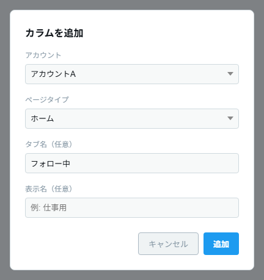
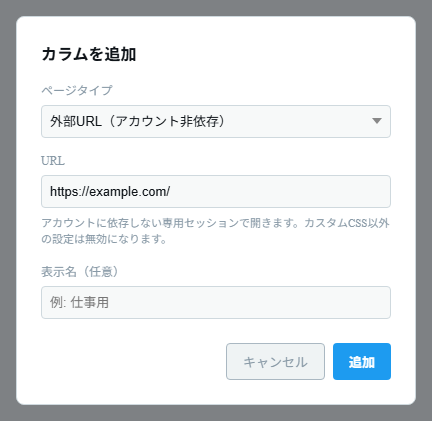
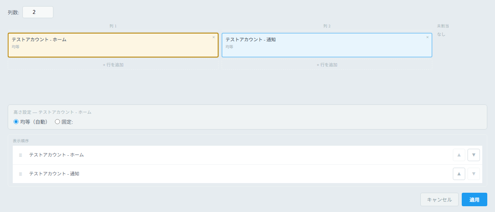
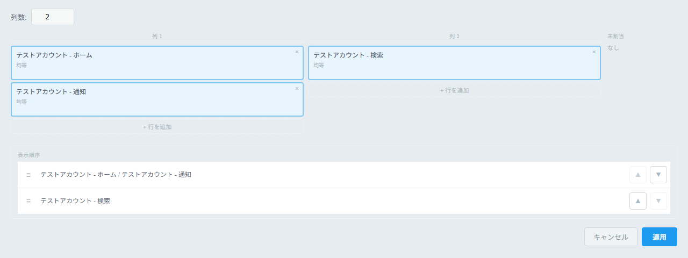
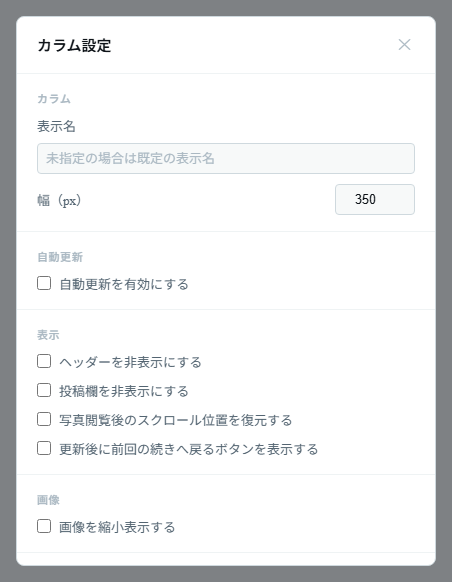

# Columns

## Using columns

### Adding a column

1. Click the **Add column** (plus icon) button in the toolbar (`Ctrl+N`).
2. Choose an **Account** (the account field is not shown when the page type is "External URL").
3. Choose a **Page type**.

   | Page type                             | What it shows                                                  | Additional input                    |
   | ------------------------------------- | -------------------------------------------------------------- | ----------------------------------- |
   | Home                                  | Home timeline                                                  | Tab name (optional, e.g. Following) |
   | Notifications                         | Notifications                                                  | —                                   |
   | Search                                | Search results                                                 | Search query (e.g. `tauri`)         |
   | Lists                                 | A list                                                         | List ID (e.g. `1234567890`)         |
   | Custom URL                            | Any X page                                                     | URL (e.g. `https://x.com/...`)      |
   | External URL (not tied to an account) | Any URL (non-X sites also work). Has its own dedicated storage | URL                                 |
   | Compose                               | A post-only column that shows just the post form               | —                                   |

4. If needed, enter a **Display name (optional)** (e.g. Work). If you leave it blank, "account name + page type" is used as the display name.
5. Click **Add** to create the column.

_Choose the account, page type, tab name, and so on, then click "Add" (the screenshot shows the Home example)._

_When you choose "External URL (not tied to an account)" as the page type, a URL field is shown instead of the account field._

### Working with columns (desktop)

Use the buttons in the column header.

- **Scroll to top** (upward chevron icon) — Scrolls the column to the top.
- **Refresh** — Refreshes the column manually.
- **Reload page** — Reloads the column's page.
- **Settings (gear)** — Opens the settings for that column ([Per-column settings](#per-column-settings)).
- **Close column (✕)** — Removes the column.

To reorder or rearrange columns, use the **"Column layout"** tab in the app settings ([Grid layout](#grid-layout-advanced)).

### Auto-reload

Auto-reload is enabled for every column by default. You can change the interval and the countdown display in the column settings, or in "Column defaults" in the app settings. Reloads are skipped while you are scrolling, so they don't get in the way of reading.

## Grid layout (advanced)

You can place columns on a grid of rows and columns. On desktop, edit it from
**App settings (`Ctrl+,`) → "Column layout" tab**.

### Basic concepts

- Columns are assigned to **grid columns** (vertical groups).
- Placing several columns in the same grid column **stacks them vertically**.
- You can freely increase the number of grid columns and the number of rows in each one.

### How to arrange

1. Open the "Column layout" tab.
2. Set **"Columns:"**.
3. Click an empty cell (`+`) in the grid to select it as the destination.
4. Click the column you want to place in the **"Unassigned"** list on the right, and it is placed in the selected cell.
5. Use **"+ Add row"** below a grid column to add more stacked cells to it.
6. Use the **×** button on a placed cell to return that column to Unassigned.

### Height settings

When you click a placed column (cell), **Height settings** appear at the bottom of the screen.

- **Even (auto)** — Divides the height evenly with the other columns in the same grid column.
- **Fixed** — Specifies the height as a number. You can choose **px** or **%** as the unit.

### Display order

Use the **▲ / ▼** buttons in the "Display order" list to change the order of the grid columns (groups).

Finally, click **"Apply"** to apply the layout.

_Assign columns to each grid column, and edit the height settings of the selected column and the "Display order"._

_Placing several columns in the same grid column stacks them vertically, and they are shown together as one group in "Display order"._

## Per-column settings

Use the **Settings (gear)** button in the column header (on Android, long-press the tab → Settings) to change settings for that column only.

| Section                        | Settings                                                                                                                                                                                                                                      |
| ------------------------------ | --------------------------------------------------------------------------------------------------------------------------------------------------------------------------------------------------------------------------------------------- |
| Column                         | Display name (the default name is used if blank), width (px, desktop only; 200–1200)                                                                                                                                                          |
| Auto-reload                    | Enable/disable auto-reload, reload interval (10–3600 seconds), countdown display                                                                                                                                                              |
| Display                        | Hide the header, hide the post box, show the custom menu button, restore scroll position after viewing photos (can be set only when "Shrink images" is on), (Home columns only) show a button to return to where you left off after reloading |
| Images                         | Shrink images (specify the width as `50%` or `200px`)                                                                                                                                                                                         |
| Image blur                     | Blur images (specify the blur amount, e.g. `10px`). Right-click (desktop) or long-press (mobile) to remove the blur temporarily                                                                                                               |
| Notifications                  | Whether to show desktop notifications for new posts (not available on Android)                                                                                                                                                                |
| Muted words                    | Enter one word per line. Posts that match are hidden (the `/regex/flags` format is also supported)                                                                                                                                            |
| Users whose reposts are hidden | Enter one user ID per line (the part after @). Posts reposted by the specified users are hidden                                                                                                                                               |
| Allowlist                      | Shows only posts that contain the specified words (the opposite of muted words)                                                                                                                                                               |
| Custom CSS                     | Write any CSS to apply to that column                                                                                                                                                                                                         |

- Use **"Reload"** at the bottom to reload the column right away.
- Changes take effect when you click **"Apply"**.

_Change settings for just that column, section by section: display name, width, auto-reload, display, and more._
