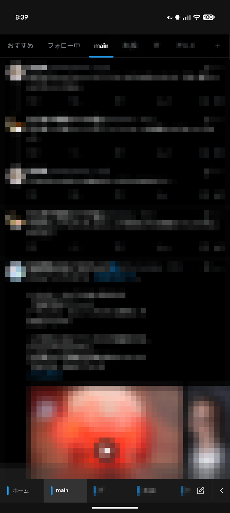

# Multi Column X User Guide

Multi Column X is an app for browsing Twitter/X in a TweetDeck-style layout.
It lets you display multiple accounts and multiple columns (timelines) side by side at the same time.
It runs on Windows / Linux desktops and on Android (see [Supported Environments and Features](./environments) for the features available in each environment).

> This guide is for people who use the app. For building from source and development, see [README.en.md](https://github.com/natsuyasai/multi-column-x/blob/main/README.en.md).

## Getting started in 5 steps (quick start)

If this is your first time, follow these steps and you can be up and running in about 5 minutes.

1. **Install** — From **Assets** on the [latest release page](https://github.com/natsuyasai/multi-column-x/releases/latest), download the file for your OS (`.exe` for Windows, `.AppImage` for Linux, `.apk` for Android) and run it. If Windows SmartScreen shows a warning, click "More info" → "Run anyway" to continue. → [Installation](./install)
2. **Add an account** — Click the "Accounts" button on the toolbar (`Ctrl+Shift+A`) → "+ Add account", then log in to X in the window that opens. → [Adding an account](./accounts)
3. **Add a column** — Click the "Add column" button on the toolbar (`Ctrl+N`), choose an account and a page type (Home, Notifications, Search, etc.), and click "Add". → [Using columns](./columns#using-columns)
4. **Check auto-refresh and settings** — Each column refreshes automatically by default. Use the gear button in the column header to change the refresh interval and display, and the app settings (`Ctrl+,`) to change global settings. → [Column settings](./columns#per-column-settings), [App settings](./settings#app-wide-settings)
5. **Compose a post / check the shortcuts** — Press `Ctrl+T` to open the compose window. Press the `?` key on a column to show the list of shortcuts. → [Popup features](./popup-shortcuts#popup-features), [Keyboard shortcuts](./popup-shortcuts#keyboard-shortcuts-advanced)

## What is Multi Column X?

_The Windows screen. You can display multiple columns such as Home, Notifications, and Search side by side at the same time (account names and timeline contents are blurred). The screenshot shows the Japanese UI._

_The Android screen. Use the tab bar at the bottom of the screen to switch between columns (timeline contents are blurred). The screenshot shows the Japanese UI._

The main features are as follows.

- **Multiple accounts** — Register multiple X accounts and use each with its own independent login state (cookies).
- **Multiple columns** — Display as many Home, Notifications, Search, List, or arbitrary URL columns as you like at the same time.
- **Grid layout** — Arrange columns in a grid of rows and columns, and stack them vertically within a column.
- **Auto-refresh** — Each column is reloaded automatically at a fixed interval (refresh is skipped while you are scrolling).
- **Fine-grained per-column settings** — Configure the auto-refresh interval, hiding the header, muted words / allowlist, hiding reposts, image shrinking and blurring, custom CSS, and more for each column individually.
- **Popup display** — Open images, videos, and links in a separate window.
- **Extensions (Windows only)** — Load Chrome / Edge extensions and use them in the columns of all accounts. → [Extensions](./settings#extensions-advanced)
- **Backup and restore** — Export account information, column layout, and settings to a file and restore them later. → [Backup and restore](./settings#backup-and-restore-advanced)
- **App auto-update** — When a new version is released, you can update from within the app (except for the Linux deb version).

The differences in available features between environments are summarized in [Supported Environments and Features](./environments).
