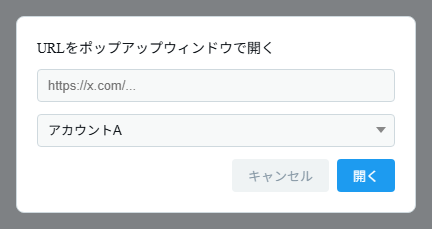
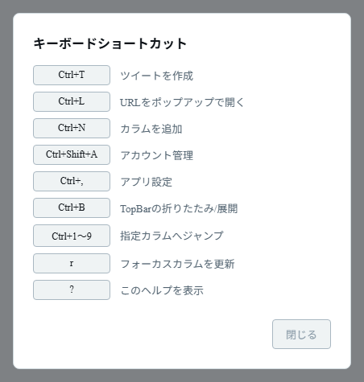

# Popups and shortcuts

## Popup features

These features open content in a separate window.

- **Media popup** — Opens images and videos from the timeline in a separate window.
- **Long-press / right-click menu on videos** — Long-press a video in a column (right-click on a PC) to open a menu where you can choose to show it in a popup or download the video (Android only). On desktop, you can't download from this menu. Use the popup toolbar instead, as described in "Downloading videos (desktop)" below.
- **Link popup** — Use the **Open URL** (link icon) button in the toolbar (`Ctrl+L`) to open any URL in a dedicated window.
- **Compose window** — Use the **Post** (pencil icon) button in the toolbar (`Ctrl+T`) to open the post composer in a separate window.
- **Switching accounts inside a popup** — Use the toolbar at the top of the popup to switch the account being shown on the spot.
- **Downloading videos (desktop)** — In a popup that is showing a video, a **"Download video"** button appears in the toolbar at the top. Play the video, then click it to choose where to save the file and download it (progress is shown in the toolbar).
- **Distributing X's official settings** — In the settings screen opened with "Open official settings" in the app settings, use the **"Apply to columns"** button in the toolbar to apply the settings to the columns of your other accounts ([App settings](./settings#app-maintenance)).

Popups can be closed with the Esc key (you can toggle this under "Popup windows" in the app settings).

_Enter a URL, choose the account to use, and click "Open" to open it in a dedicated window._

## Keyboard shortcuts (advanced)

> Shortcuts are available in the desktop versions (Windows / Linux). They don't work on Android. For differences between environments, see [Supported environments and features](./environments). Unless noted otherwise, shortcuts are used together with the **Ctrl** key.

| Shortcut             | Action                        |
| -------------------- | ----------------------------- |
| `Ctrl+T`             | Open the compose window       |
| `Ctrl+L`             | Open a URL in a popup         |
| `Ctrl+N`             | Add a column                  |
| `Ctrl+Shift+A`       | Open account management       |
| `Ctrl+,`             | Open the app settings         |
| `Ctrl+B`             | Collapse/expand the toolbar   |
| `Ctrl+1` to `Ctrl+9` | Jump to the 1st to 9th column |
| `r`                  | Reload the focused column     |
| `?`                  | Show the list of shortcuts    |

`r` and `?` are used without Ctrl (they are disabled while you are typing text).

_The list of shortcuts shown with the `?` key. Close it with "Close"._
