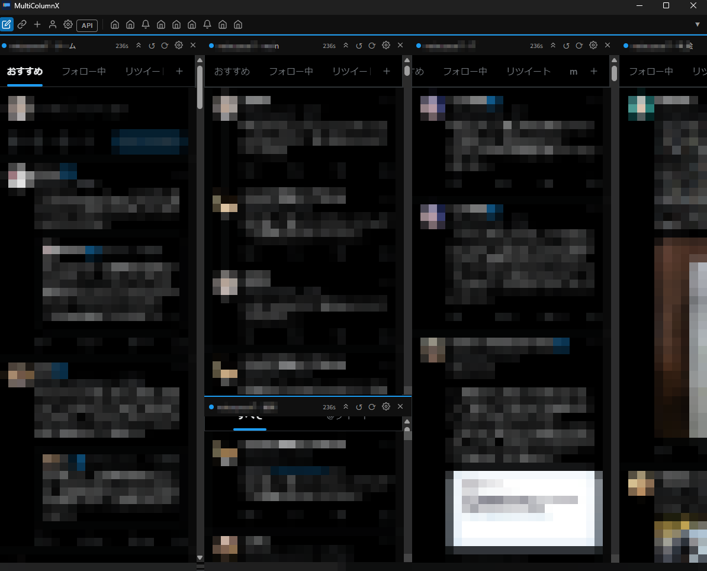
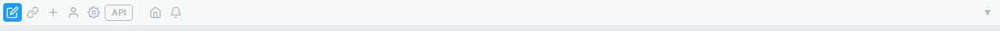
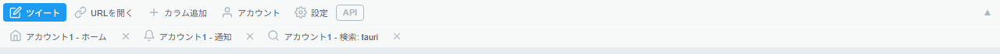
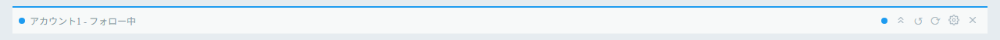

# First Launch and Screen Layout

Right after launch, there are no accounts or columns. See [Supported Environments and Features](./environments) for the differences between environments. First [add an account](./accounts), then [add a column](./columns#using-columns).

## Desktop (Windows / Linux)

_An actual Windows screen. Multiple columns are arranged below the toolbar at the top (account names and timeline contents are blurred). The screenshot shows the Japanese UI._

There is a **toolbar (TopBar)** at the top of the screen. The following buttons are arranged from the left (each button is shown as an icon).

| Button (icon)     | Function                | Shortcut       |
| ----------------- | ----------------------- | -------------- |
| Post (pencil)     | Open the compose window | `Ctrl+T`       |
| Open URL (link)   | Open any URL in a popup | `Ctrl+L`       |
| Add column (+)    | Add a column            | `Ctrl+N`       |
| Accounts (person) | Open account management | `Ctrl+Shift+A` |
| Settings (gear)   | Open the app settings   | `Ctrl+,`       |
| API               | Show API rate limits    | —              |

- The **API** button shows the rate-limit status of X's internal API in a popover. You can turn the display on or off with "API usage monitor" in the "General" tab of the app settings (enabled by default).
- The **▼ / ▲** button at the right end collapses / expands the toolbar (`Ctrl+B`).
- When collapsed, only icons are shown; when expanded, buttons are shown with labels.

_When collapsed, only icons are shown, and a list of column icons appears on the right. (The screenshot shows the Japanese UI.)_

_When expanded, the buttons have labels, and the list of registered columns appears in the row below. (The screenshot shows the Japanese UI.)_

- The toolbar also lists the registered columns; clicking one scrolls to that column.
- Dragging each toolbar column (the area where the column buttons are lined up) by 8px or more lets you reorder columns by column position. If you click without dragging, it jumps to / closes the column as before (reordering with the keyboard is not supported; you can reorder from the "Column layout" tab in the app settings).
- Columns with multiple rows in the same column position are grouped into a single element on the toolbar and move together.
- The order is kept after restart and is also reflected in the actual column layout.

Below the toolbar, the columns you have added are shown side by side (and in a grid layout).

## Android

There is a **tab bar** at the bottom of the screen. Each tab corresponds to one column; tap a tab to switch. See [Using on Android](./android) for details.

## Reading the column header (desktop)

Each column has a header at the top that shows the following information and controls.

- The colored dot at the left edge / the colored line on the top edge … the color of the account used by that column
- The column name (account name + page type, or the label you set)
- Unread badge … a dot shown when there are unread posts. Click it to clear
- Countdown (`NNs`) … the number of seconds until the next auto-refresh
- **Scroll to top** (upward chevron icon) / **↺** (Refresh) / **⟳** (Reload page) / **Settings** (gear) / **Close column** (✕) buttons

_The colored dot, column name, unread badge, and action buttons are lined up in a single row. (The screenshot shows the Japanese UI.)_
