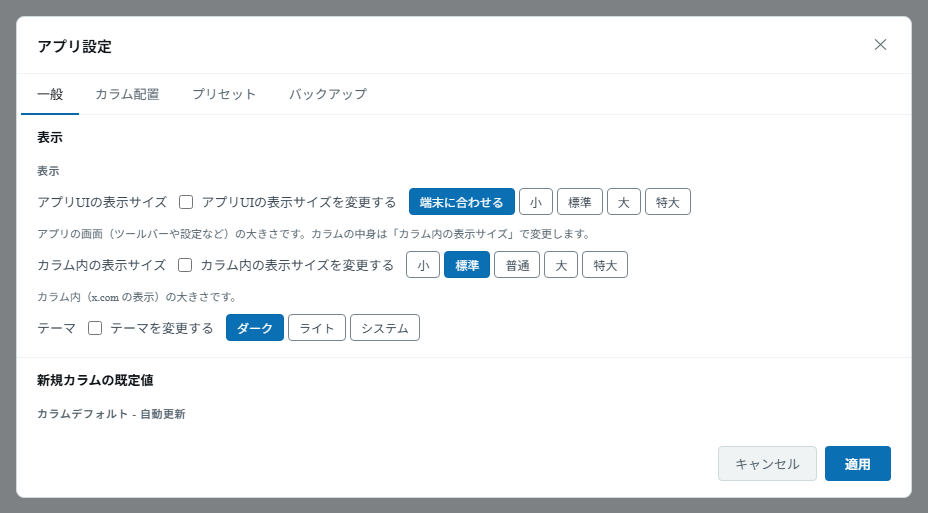
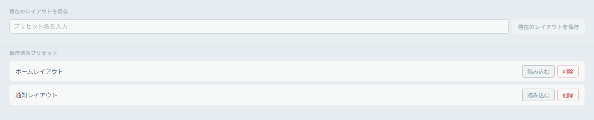
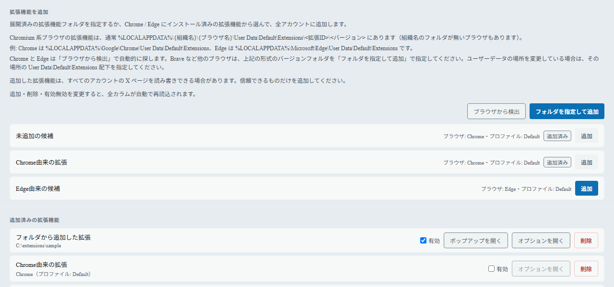
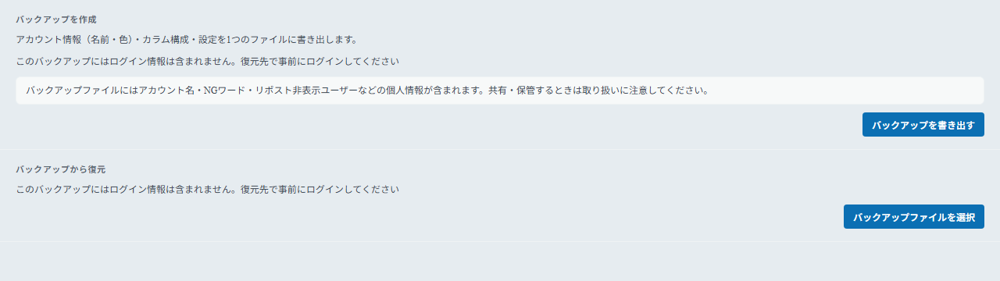
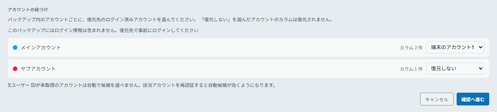

# Settings

## App-wide settings

Click the **Settings** (gear icon) button on the toolbar (`Ctrl+,`) to open the app-wide settings. It has the following tabs.

| Tab           | Contents                                                                        | Availability |
| ------------- | ------------------------------------------------------------------------------- | ------------ |
| General       | App-wide settings such as display, defaults for new columns, filters, and media | All          |
| Column layout | Column placement and order ([grid layout](./columns#grid-layout-advanced))      | All          |
| Presets       | Save and load layouts                                                           | Desktop only |
| Extensions    | Add and manage Chrome / Edge extensions                                         | Windows only |
| Backup        | Export and restore your settings and column setup                               | All          |

Differences between environments are also summarized in [Supported Environments and Features](./environments).

### Main items on the "General" tab

_On the "General" tab you can configure the app UI display size, the display size inside columns, the theme, the column defaults, and more in one place. (The screenshot shows the Japanese UI.)_

The items on the "General" tab are divided into the following groups.

#### Display

- **App UI display size** — The size of the app itself, such as the toolbar and the settings screens. The default is "Match device" (on Android it follows the device's font size setting). You can also fix it to "Small / Standard / Large / Extra large" (check "Change the app UI display size" to enable the selection). This is separate from the size of the content inside columns.
- **Display size inside columns** — Choose the zoom level inside columns (the x.com display) from "Small / Standard / Normal / Large / Extra large" (check "Change the display size inside columns" to enable the selection).
- **Theme** — Choose from "Dark / Light / System" (check "Change the theme" to enable the selection).

#### Defaults for new columns

Set the initial values for newly added columns (auto-reload, display, images, image blur, and custom CSS) in one place.

- **Custom CSS** can be applied to every existing column at once with the **"Apply to all existing columns"** button.

#### Browsing & filters

- **Global muted words** — Muted words applied to all columns (used together with each column's own muted words). You can also write them in the `/regex/` format.
- **Users whose reposts are hidden** — Hides posts reposted by the specified users (one user ID per line) in all columns (used together with each column's own setting).
- **Ads** — Whether to hide ads.
- **API usage monitor** — Whether to enable the API button on the toolbar (which shows API rate limits).

#### Media

- **Video** — Whether to stop videos from autoplaying.
- **Popup windows** (desktop only) — Whether to close with the Esc key, and whether to open images and videos in a popup window.
- **Video playback (Linux)** (Linux only) — Toggles **"Use hardware decoding (VA-API)"**. In the AppImage version, **"Enable H.264"** gets the decoder needed to play videos. Both take effect only after a restart (a "Restart now" button appears).

#### Android only

Shown only on Android. It includes items such as "Launch the X app with the post button", "Enable swiping to switch columns", and "Show multiple columns on wide screens (tablet / landscape)" ([Using on Android](./android)).

#### App & maintenance

- **Official settings** — **"Open official settings"** opens X's official settings screen in a popup window. With the **"Apply to each column"** button on that screen, you can apply those settings to the columns of your other accounts.
- **WebView** — **"Recreate all WebViews"** recreates all columns in turn (your settings are kept; use it to recover when the display is broken).
- **About the app** — Shows the current version and the **"Check for updates"** button ([Updating the App](./update)).
- **Delete data folders** — Shown only when data folders that could not be deleted remain. **"Retry deleting data folders"** retries the deletion.

Settings take effect when you press **"Apply"**.

## Presets (advanced)

> Presets are a desktop feature.

Save your current column setup (layout) under a name and load it all at once later. This is handy when you want to switch layouts by purpose, such as work and hobby.

1. Open App settings (`Ctrl+,`) → the **"Presets" tab**.
2. Enter a name under **"Save current layout"** and press the save button.
3. Saved presets appear in the list, where you can use
   - **"Load"** … to switch to that layout.
   - **"Delete"** … to delete the preset.

_Save the current layout under a name, then choose "Load" or "Delete" from the list. (The screenshot shows the Japanese UI.)_

## Extensions (advanced)

> Extension management is **available on Windows only**. The "Extensions" tab is not shown on other OSes or on Android.

You can load Chrome / Edge extensions (those that modify pages with content scripts, those with popups or options pages, and so on) into your columns. Added extensions work in the columns of **all accounts**.

Open App settings (`Ctrl+,`) → the **"Extensions" tab**, and add an extension in either of the following ways.

- **"Detect from browser"** … Extensions installed in Chrome / Edge on your computer are listed as candidates. Each candidate shows the browser it comes from (Chrome / Edge), and if the same extension exists in both, only the Chrome one is shown. Press **"Add"** on the one you want (already-added ones show "Added"). If neither browser is found, "Chrome / Edge not found" is shown.
- **"Add from folder"** … Choose an unpacked extension folder (a folder containing `manifest.json`). Network folders and folders without a `manifest.json` cannot be added.

The add section also shows where extensions are stored. Extensions for Chromium-based browsers are usually located at `%LOCALAPPDATA%\{organization}\{browser}\User Data\Default\Extensions\<extension ID>\<version>` (Chrome is at `%LOCALAPPDATA%\Google\Chrome\User Data\Default\Extensions`, and Edge is at `%LOCALAPPDATA%\Microsoft\Edge\User Data\Default\Extensions`). For extensions of other browsers such as Brave, or if you have changed the user data location, specify a version folder in this format with "Add from folder".

After adding, the "Added extensions" list also shows the browser each one comes from, and you can do the following.

- **Enabled** … Use the checkbox to enable or disable the extension.
- **Open popup / Open options** … Shown when the extension has a popup or an options page. It opens in a separate window.
- **Delete** … Removes the extension from the list.

When you add, delete, or enable/disable an extension, **all columns are reloaded automatically**.

_Candidates from "Detect from browser" and the list of added extensions. You can enable or disable them, show their popups and options, and delete them. (The screenshot shows the Japanese UI.)_

> **Note** — Added extensions may be able to read and modify X pages for all accounts. Only add extensions you trust.
>
> Extensions that depend on Chrome-specific features (such as `sidePanel`) may be added but have some features that do not work. In particular, extensions that detect the content of the open page and are used from a toolbar button may not work, because their popups open in a separate window. Extensions whose original folder was moved or deleted, or that were removed from Chrome / Edge, show "Not found" and are treated as disabled.

## Backup and restore (advanced)

You can export account info (names and colors), column layout, and settings to a single file and restore them later. This is handy when you change devices or want to rebuild your setup.

> **Backups do not include login information (cookies).** You need to log in to X on the destination beforehand. Also, the file contains personal information such as account names, muted words, and users whose reposts are hidden, so be careful when sharing or storing it.

### Create a backup

1. Open App settings (`Ctrl+,`) → the **"Backup" tab**.
2. Press **"Export backup"** and choose where to save it (the default file name is `.mcxbackup.json`).

_"Create a backup" and "Restore from backup" are shown side by side. (The screenshot shows the Japanese UI.)_

### Restore from a backup

1. In the destination app, first add (log in to) accounts that correspond to the accounts in the backup.
2. On the "Backup" tab, press **"Select backup file"** and choose the file.
3. **Link accounts** — For each account in the backup, choose a logged-in account on the destination. Columns of accounts set to "Don't restore" are not restored.
4. **Confirm restore** — Check the number of columns to be restored and skipped, then press **"Replace and restore"**.

_For each account in the backup, choose the account to restore to. (The screenshot shows the Japanese UI.)_

> Restoring **replaces** your current columns and settings (except window position) with the backup contents. Accounts themselves are not replaced. Your settings just before restoring are backed up automatically.
