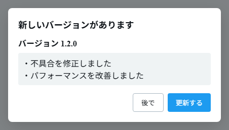
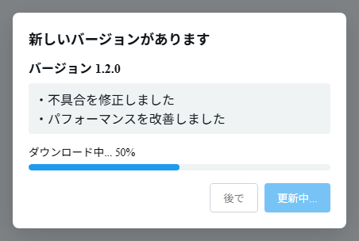

# Updating the app

You can check for and apply new versions from within the app.

- **Automatic check at startup** — The app checks for a new version when it starts.
- **Manual check** — You can check at any time with the **"Check for updates"** button under App settings (`Ctrl+,`) → "General" → "About the app".

When a new version is available, the **"A new version is available"** dialog appears.

_The new version number and release notes are shown, and you can choose "Update" or "Later"._

_When you click "Update", the download progress is shown._

- **Update** — Downloads and applies the update.
  - Windows / Linux (AppImage) … Installs after the download finishes, and the app restarts.
  - Linux (deb) … In-app updates aren't supported. Download the new `.deb` from Assets on the [latest release page](https://github.com/natsuyasai/multi-column-x/releases/latest) and install it over the existing one with `sudo apt install ./MultiColumnX_*.deb` ([Installation](./install#linux)).
  - Android … Downloads the latest APK and launches the installer. Follow the on-screen instructions to install it.
- **Later** — Skips the update this time. A version you dismissed won't be announced again; you'll be notified again when the next new version is released, or when you manually click "Check for updates".

> On Windows, a SmartScreen warning may appear when you launch the app after an update. You can continue using the same steps as in [Installation](./install).
