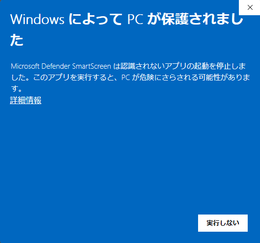
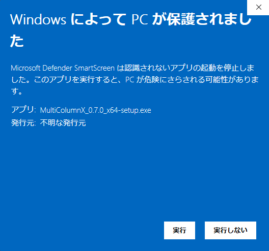
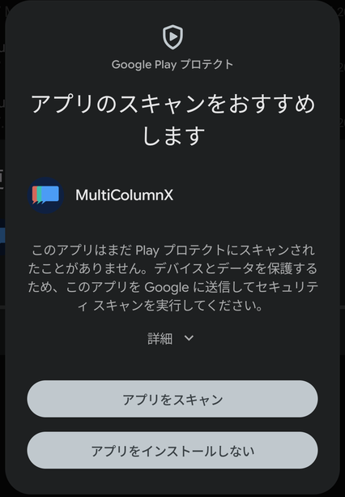
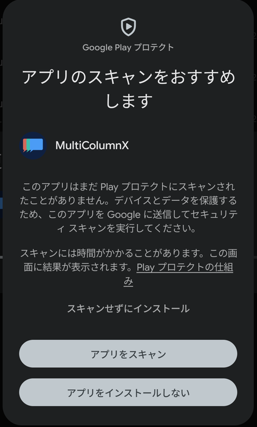

# インストール

最新版は GitHub の [最新リリースのページ](https://github.com/natsuyasai/multi-column-x/releases/latest) からダウンロードします。ページ下部の **Assets** を開き、お使いの OS に合ったファイルを選んでください。

> 以降のファイル名にある `<バージョン>` の部分はバージョン番号で、リリースごとに変わります。

| OS      | ダウンロードするファイル（Assets 内）                                    |
| ------- | ------------------------------------------------------------------------ |
| Windows | `MultiColumnX_<バージョン>_x64-setup.exe`                                |
| Linux   | `MultiColumnX_<バージョン>_amd64.AppImage`（推奨）または `..._amd64.deb` |
| Android | `MultiColumnX_<バージョン>_universal.apk`                                |

> `.sig` や `.sha256` で終わるファイルと `latest.json` は、アプリの更新や検証に使うファイルです。ダウンロードする必要はありません。

> Multi Column X は OS のコード署名を行っていないため、インストール時に「提供元が確認できない」旨の警告が表示されることがあります。これは仕様です。配布元（GitHub Releases）からダウンロードしたファイルであることを確認のうえ、続行してください。

## Windows

1. 最新リリースの Assets から `MultiColumnX_<バージョン>_x64-setup.exe`（インストーラー）をダウンロードします。
2. ダブルクリックで実行します。
3. **SmartScreen の警告**（「Windows によって PC が保護されました」）が出た場合は、
   **「詳細情報」** をクリック → **「実行」** ボタンを押すとインストールが続行できます。
4. 画面の指示に従ってインストールします。

_最初は「実行しない」しか表示されません。「詳細情報」をクリックします。_

_「詳細情報」を開くと「実行」ボタンが表示されます。アプリ名と発行元（不明な発行元）を確認して「実行」を押します。_

## Linux

次のいずれかを利用できます。

- **AppImage**（推奨・アプリ本体の自動更新に対応）
  1. Assets から `MultiColumnX_<バージョン>_amd64.AppImage` をダウンロードします。
  2. 実行権限を付与します: `chmod +x MultiColumnX_*.AppImage`
  3. ダブルクリック、または `./MultiColumnX_*.AppImage` で起動します。
- **deb パッケージ**（Debian / Ubuntu 系・手動更新）
  1. Assets から `MultiColumnX_<バージョン>_amd64.deb` をダウンロードします。
  2. `sudo apt install ./MultiColumnX_*.deb` でインストールします。

## Android

1. 最新リリースの Assets から `MultiColumnX_<バージョン>_universal.apk` をダウンロードします。
2. インストール時に **「不明なアプリのインストール」** を求められた場合は、設定でこのアプリ（ブラウザやファイルアプリ）からのインストールを許可します。
3. APK を開いてインストールします。
4. **Google Play プロテクト** の「アプリのスキャンをおすすめします」が表示された場合は、**「アプリをスキャン」** を選ぶか、**「詳細」** を開いて **「スキャンせずにインストール」** を選ぶとインストールを続行できます。

_APK は Google Play 経由ではないため、スキャンの確認が表示されることがあります。「詳細」を押すと続行の選択肢が現れます。_

_「詳細」を開いた状態。「スキャンせずにインストール」でそのまま進められます。_

> 表示される文言や選択肢は、Android のバージョンや端末によって異なります。

> インストール後のアプリ本体のバージョンアップについては [アプリの更新](./update) を参照してください。
