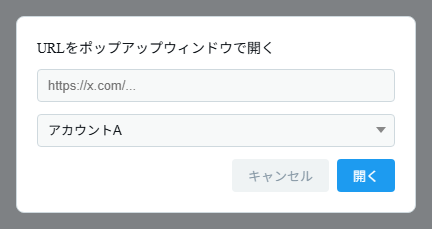
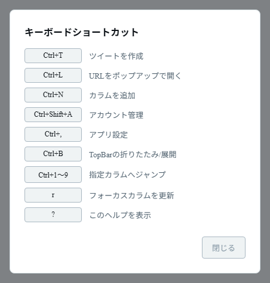

# ポップアップとショートカット

## ポップアップ機能

別ウィンドウでコンテンツを開く機能です。

- **メディアポップアップ** — タイムライン上の画像・動画を別ウィンドウで開きます。Android では、複数カラムを同時に表示しているあいだだけ全画面のポップアップで開きます（1 列表示ではカラム内で開きます）。
- **動画の長押し／右クリックメニュー** — カラム上の動画を長押し（PC は右クリック）すると、ポップアップ表示や動画のダウンロードを選べるメニューが開きます（Android では「ポップアップ表示」は複数カラム表示中のみ選べます）。デスクトップでは、メニューから「動画をダウンロード」を選ぶと保存先の選択画面が開き、進捗はカラム下端のトーストに表示されます（完了・失敗の表示は数秒で消えます）。保存先の選択をキャンセルした場合は何も表示されません。
- **リンクポップアップ** — ツールバーの **URL を開く**（リンクアイコン）ボタン（`Ctrl+L`）から、任意の URL を専用ウィンドウで開きます。
- **ツイート作成ウィンドウ** — ツールバーの **ツイート**（鉛筆アイコン）ボタン（`Ctrl+T`）から、ツイート作成画面を別ウィンドウで開きます。
- **ポップアップ内のアカウント切替** — ポップアップ上部のツールバーから、表示中のアカウントをその場で切り替えられます。
- **動画のダウンロード（デスクトップ）** — 動画が表示されているポップアップでは、上部のツールバーに **「動画をダウンロード」** ボタンが現れます。動画を再生してから押すと、保存先を選んでダウンロードできます（進捗はツールバーに表示されます）。
- **X 公式設定の配布** — アプリ設定の「公式設定を開く」で開いた設定画面では、ツールバーの **「各カラムに適用」** ボタンで設定を他のアカウントのカラムへ適用できます（[アプリ全体設定](./settings#閲覧・フィルタ)）。

ポップアップは Esc キーで閉じられます（アプリ設定の「ポップアップウィンドウ」で切り替え可能）。

_URL を入力し、使うアカウントを選んで「開く」を押すと専用ウィンドウで開きます。_

## キーボードショートカット（応用）

> ショートカットはデスクトップ版（Windows / Linux）で利用できます（Android では使えません）。環境ごとの違いは [対応環境と機能一覧](./environments) を参照してください。特に記載のないものは **Ctrl** キーと組み合わせます。

| ショートカット       | 機能                         |
| -------------------- | ---------------------------- |
| `Ctrl+T`             | ツイート作成ウィンドウを開く |
| `Ctrl+L`             | URL をポップアップで開く     |
| `Ctrl+N`             | カラムを追加する             |
| `Ctrl+Shift+A`       | アカウント管理を開く         |
| `Ctrl+,`             | アプリ全体設定を開く         |
| `Ctrl+B`             | ツールバーの折りたたみ／展開 |
| `Ctrl+1` 〜 `Ctrl+9` | 1〜9 番目のカラムへ移動      |
| `r`                  | フォーカス中のカラムを更新   |
| `?`                  | ショートカット一覧を表示     |

`r` と `?` は Ctrl なしで操作します（文字入力中は無効です）。

_`?` キーで表示されるショートカット一覧です。「閉じる」で閉じます。_
